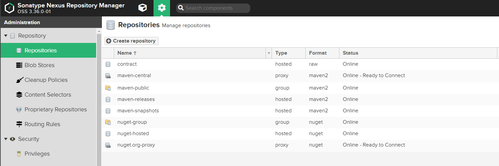
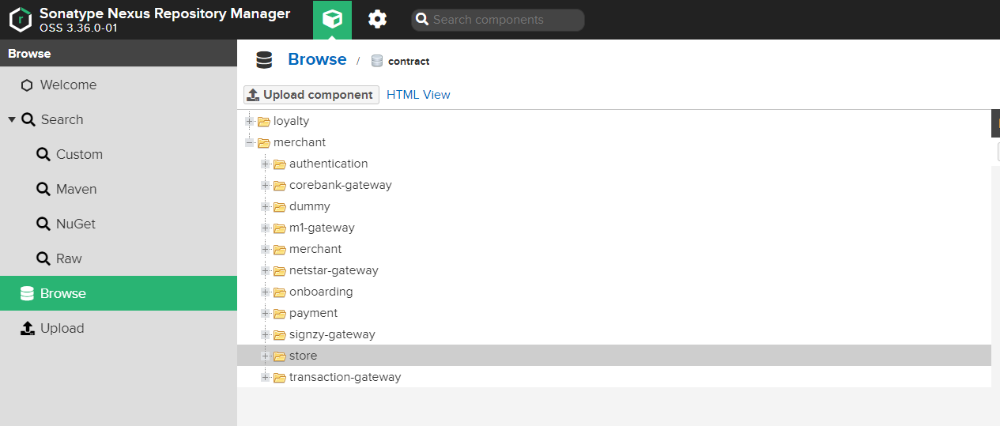

# Open API Contract

## Getting started
This project is a part of a big picture on how we manage openApi specifications in specific services

## Setup Nexus Local
- Using Docker to pull nexus/sonatype3, install and start nexus
- Access to nexus page http://localhost:8081/, setting username/password 
- create repository "contract" with type "hosted", format "raw"

## How to use
Add/update your openApi schema under contract folder.
The structure like bellow
- contract
  - store -> this is your context, consumer service
  - merchant -> this is your context, producer service

# Practice
1. Define you openApi yaml spec first
2. Commit it by using this repo
3. Make sure you have a correct version

# CI/CD
Please provide following environment variables
- NEXUS_USER
- NEXUS_PASSWORD
- NEXUS_HOST

# How to run
`./gradlew clean run`

